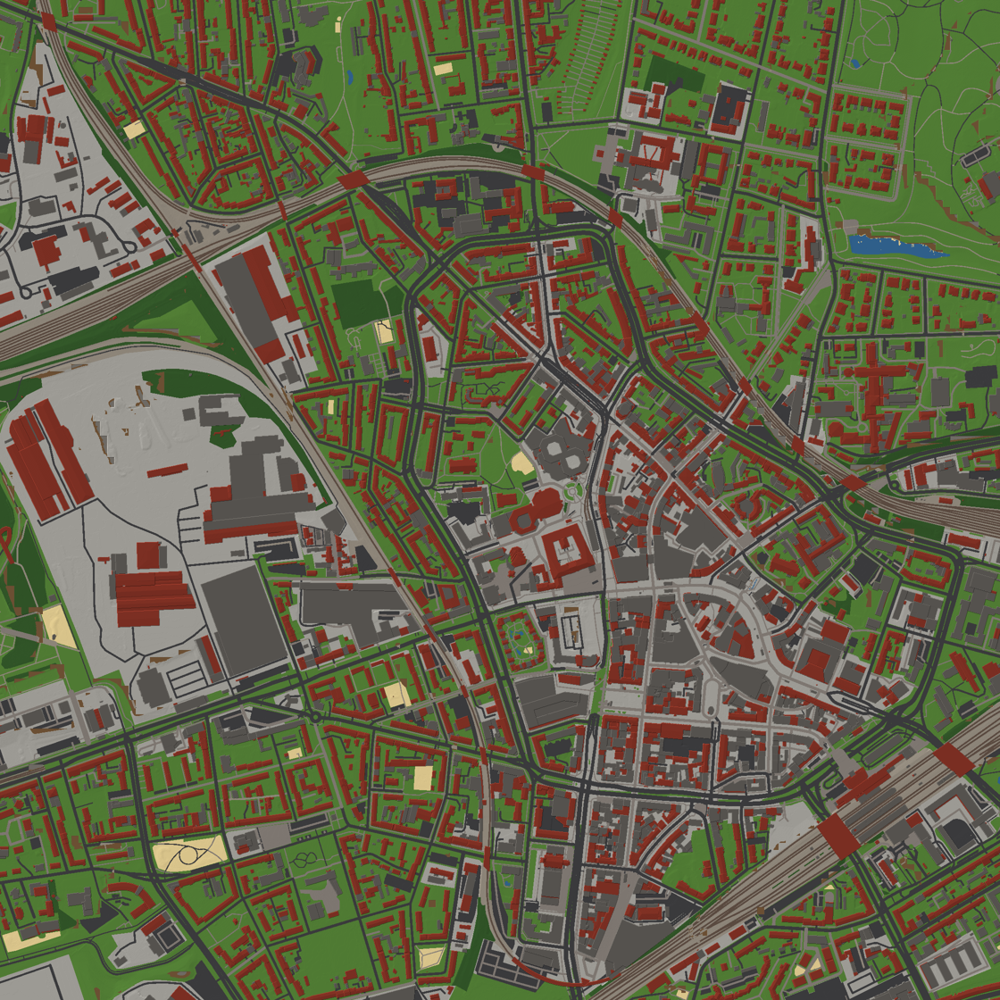
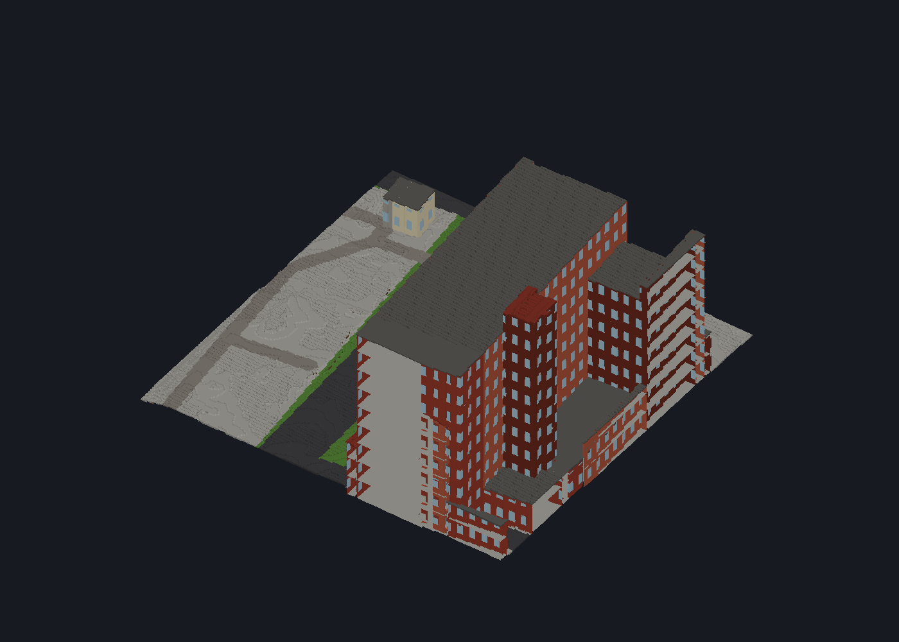
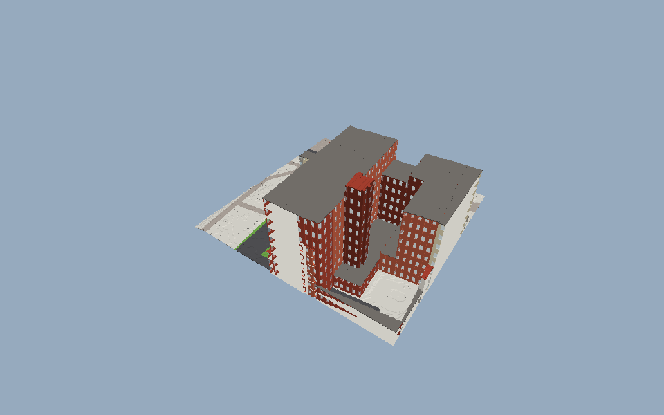
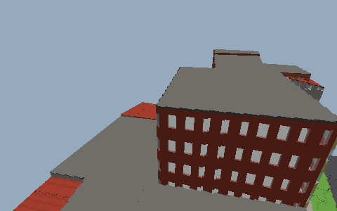

# Weltpipeline: Stand M1

Wie aus den Rohdaten Voxel-Chunks werden (Konzept, Abschnitt 2), mit den Formaten, die dabei entstehen.

```
data/raw/dgm1/*.tif  ─┐
data/raw/lod2/*.gml  ─┼─ raser import ──► world/tiles/<x>_<y>.json + .rrh ── raser voxelize ──► world/chunks/<x>_<y>/*.rrc + manifest.json
data/raw/osm/*.osm   ─┘                    (Zwischenlayer)               ▲                       (Voxel-Chunks)
                                                                    overrides/*.json
```

## Die Solution

| Projekt | Art | Inhalt |
|---|---|---|
| `src/Raser.Core` | Bibliothek (`raser.core`) | Raster und Schlüssel (`Grid`, `TileKey`, `ChunkKey`), Voxel (`Material`, `Materials`, `Palette`, `Shape`), `Chunk` mit Kodierung, globale IDs, `ByteWriter`/`ByteReader`, FNV-1a, Sortieren |
| `src/Raser.World` | Bibliothek (`raser.world`) | Zwischenlayer (`Tile`, `TileData`, `Building`, `Road`, `Area`, `Poi`, `HeightRaster`), Geometrie, Override-Layer, `Voxelizer`, `FileTileStore`, `TileGenerator` |
| `src/Raser.Import` | Bibliothek (`raser.import`) | XML-Pull-Parser, GeoTIFF (LZW, Float32), WGS84 → UTM 32, CityGML LoD2, OSM-XML, `Region` (schneidet alles in Kacheln) |
| `src/Raser.Store` | Bibliothek (`raser.store`) | der Zwischenlayer in PostGIS (`data.postgres` von fire): Merkmale global mit Geometrie (WKB, verlustfrei), eine Kachel ist eine räumliche Abfrage |
| `src/Raser.Mesh` | Bibliothek (`raser.mesh`) | Chunk-Meshing: Greedy Meshing für volle Voxel, Höhen-Schnitte als schräge Oberseiten und Trapez-Seiten, Glas und Wasser in einem eigenen Teil |
| `src/Raser.Viewer` | Programm | Betrachter mit scene3d: lädt und vernetzt die Chunk-Säulen um einen Punkt, fliegende Kamera (W/A/S/D, Q/E, Pfeile), `--shot bild.png` rendert ohne Fenster |
| `src/Raser.Tool` | Programm | `raser import`, `voxelize`, `export png`, `export obj`, `info` |

Jede Bibliothek hat ihre Tests in `testing/` (`forge test src/Raser.World/Raser.World.fireproj`, oder alle: `forge test RuhrpottRaser.firesln`).

## Ablauf

```bash
tools/fetch-bochum.sh                 # Rohdaten der Testregion (rund 230 MB)
FORGE=/pfad/zu/forge tools/build-bochum.sh
```

Das Werkzeug läuft in der VM (`forge run RuhrpottRaser.firesln -- info`), für echte Daten aber nativ: `forge build RuhrpottRaser.firesln --engine native -m RELEASE`
baut `src/Raser.Tool/bin/linux-rel/Raser.Tool`. Gemessen an der Testregion (Bochum-Innenstadt, 2 × 2 km, 49 vollständige Kacheln):

| Schritt | Dauer (nativ) |
|---|---|
| Import (4 DGM1-Kacheln, 4 LoD2-Kacheln mit rund 10.000 Gebäuden und Gebäudeteilen, 16 OSM-Ausschnitte) | rund 32 s (in PostGIS rund 80 s) |
| Voxelisierung je Kachel (rund 1.200 Chunks, 155 Mio. Voxel) | rund 47 s (49 Kacheln: 31 min, 193 MB Chunks) |
| Draufsicht je Kachel | rund 24 s |

Die Zeit der Voxelisierung geht fast ganz in die Elementzugriffe auf Byte-Puffer (docs/FIRE.md).

## PostGIS

Mit `--db postgres://host:5432/raser` (Benutzer `--db-user`, Standard `postgres`; Passwort in `RASER_DB_PASSWORD`) liest und schreibt jeder Befehl den
Zwischenlayer in PostGIS statt in `world/tiles`; die Chunks bleiben Dateien unter `--world`. Das Schema (`db/schema.sql`) legt der Store selbst an.

- Gebäude, Straßen, Flächen und POIs liegen **global** mit absoluten Koordinaten und GiST-Index; die Quelle (`lod2:...`, `osm:way/...`) ist der Schlüssel,
  dasselbe Gebäude aus zwei Kacheln ist eine Zeile. Eine Kachel ist die Abfrage über ihr Rechteck mit 1 m Rand (`&&` mit `ST_MakeEnvelope`).
- Geometrien gehen als WKB hin und zurück (`Raser.Wkb`, mit den typisierten Pufferzugriffen von fire): keine Rundung über Text.
- Testregion: 49 Kacheln, 9.165 Gebäude, 3.963 Straßen, 575 Flächen, 3.396 POIs, 30 MB; Import mit Datenbank rund 80 s (Dateien: 32 s).
- Die Voxelisierung aus PostGIS ergibt dieselben Chunks wie aus den Dateien (an der Rathaus-Kachel geprüft: 1.227 von 1.227 byte-gleich). Dafür hängt sie
  seit Generator 3 nicht mehr von der Reihenfolge der Merkmale ab: bei Gleichstand gewinnt die kleinere ID.
- Tests gegen eine Datenbank: `RASER_TEST_POSTGRES=postgres://127.0.0.1:5432/raser_test RASER_TEST_POSTGRES_PASSWORD=... forge test src/Raser.Store/Raser.Store.fireproj`
  (eine leere Datenbank mit PostGIS; ihre Tabellen werden geleert).

## Koordinaten

- Welt: ETRS89 / UTM 32N (EPSG:25832), x Ost, y Nord, z Höhe über NHN, Meter.
- Voxel: 20 cm, `floor(meter * 5)`. Chunk: 64³ Voxel = 12,8 m. Kachel: 256 × 256 m = 20 × 20 Chunk-Säulen, ohne Höhe.
- Im Zwischenlayer sind Lagen kachel-lokal (Südwest-Ecke = 0, 0), Höhen absolut.

## Zwischenlayer: `world/tiles/<x>_<y>.json` und `.rrh`

`TileData` als JSON (ohne `$type`): `quarter`, `mood`, `sources`, `buildings`, `roads`, `areas`, `pois`. Jedes Merkmal hat `id` (stabil, `Raser.Ids.Stable`) und `source`.
Merkmale, die über den Rand reichen, stehen in jeder Kachel, die ihr Rechteck berührt.

- Gebäude: aus jedem `bldg:Building`/`bldg:BuildingPart` mit eigener Geometrie, je Grundfläche eines. `footprint` (Ring), `ground` (tiefster Punkt der Grundfläche),
  `eaves`/`ridge` (tiefster/höchster Dachpunkt), `roofs` (die LoD2-Dachflächen), `roofType` (ALKIS-Dachform), `function` (`alkis=<code>`, oder ein OSM-POI im Grundriss: `amenity=fuel` ...), `name`.
- Straßen: OSM `highway=*` (ohne Tunnel, ohne `proposed`/`construction`), Bahnen (`railway=rail|light_rail|subway|tram`, ohne eingebettete Straßenbahn); Breite aus `width` oder nach Art.
- Flächen: Wasser, Parkplätze, Plätze, Sport- und Spielplätze, Wald, Grün, Felder, Bahngelände, Gewerbe/Handel - mit Priorität bei Überlappung.
- `.rrh`: das Höhenraster, 258 × 258 Höhen im Abstand von 1 m auf den Pixelmitten des DGM1 (-0,5 .. 256,5 m), in Zentimetern als Differenzen (Varints).

## Voxel-Chunks: `world/chunks/<x>_<y>/<cx>_<cy>_<cz>.rrc`

Deflate über `Chunk.Encode()`: `RRC1`, Schlüssel, Generator-Version, Hash der Overrides, Seed, dann Material + Farbe als Lauflängen (Varint-Länge, Byte, Byte),
dann die Formen (Höhen-Schnitte) und der Teilschaden als (Abstand zum vorigen Index, Byte). Leere Chunks (nur Luft) werden nicht gespeichert.

`manifest.json` hält fest, womit die Kachel erzeugt wurde: `generatorVersion`, `overridesHash`, `seed`, `dataHash` (alle Hashes als 16 Hex-Ziffern), die Chunks und die Zahl der Voxel.
`raser voxelize` überspringt Kacheln, bei denen alles passt; `--force` erzeugt neu.

## Voxelisierung

Je Chunk-Säule wird einmal ein Plan der 64 × 64 Voxel-Säulen gerechnet (gilt für alle Chunks übereinander):

- Gelände: Eckhöhen aus dem Raster an den Säulen-Ecken; die Oberfläche liegt im Voxel der höchsten Ecke, die vier Ecken auf 5 cm gerundet (Viertel). Darunter 2 Voxel
  Unterbau (Erde, unter Straßen Schotter, unter Wasser Sand), bis 2 m Erde, darunter Fels.
- Flächen und Grundrisse werden zeilenweise gerastert, Straßen segmentweise; die breiteste Straße und die Fläche mit der höchsten Priorität gewinnen.
- Gebäude: Säulen, deren Mitte im Grundriss liegt; Rand = Wand mit Fensterreihen (Glas) je Geschoss (2,8 m), innen Decken; das Dach-Voxel mit Eckhöhen aus den LoD2-Ebenen
  (sonst aus Dachform, Traufe und First). Wohnhäuser (ALKIS 31001_1xxx) in Ziegel, der Rest verputzt; Farbvarianten aus ID und Seed.
- Alle Lagen werden aus dem kachel-lokalen Voxel-Index gerechnet, damit Nachbar-Chunks dieselbe Säule gleich sehen. Zwei Läufe mit denselben Daten ergeben dieselben Bytes.

## Export zur Kontrolle

- `raser export png [--tile x_y] [--step n]`: Draufsicht, die Farbe des obersten Voxels je Säule mit Hangschattierung; ohne `--tile` alle Kacheln in einem Bild.
- `raser export obj --at ost,nord [--size m]`: die Chunk-Säulen um den Punkt als OBJ + MTL, vernetzt mit `Raser.Mesh` (rund 7.000 Vierecke je Chunk in der Innenstadt), für Blender oder jeden anderen Betrachter.



*Die Testregion Bochum-Innenstadt (2 × 2 km, 49 Kacheln, 0,8 m je Pixel): Flachdächer grau, Steildächer rot, Straßen, Grün, Wasser; keine Nähte an den Kachelgrenzen.*



*Ein Ausschnitt am Rathaus als Netz: Wände mit Fensterreihen je Geschoss, Decken, Flach- und Steildächer, Straße und Grünstreifen.*

## Betrachter

```bash
forge build RuhrpottRaser.firesln -p Raser.Viewer --engine native -m RELEASE
src/Raser.Viewer/bin/linux-rel/Raser.Viewer --world world --at 376130,5704900 --radius 2 --distance 110 --pitch -40 --shot rathaus.png
```

Je Chunk und Farbe wird ein scene3d-Modell aus `Model.FromArrays` gebaut (Anker auf der unteren Ecke, damit die Lage stimmt). Um das Rathaus (Radius 2, 5 × 5 Chunk-Säulen)
sind das 273 Objekte mit rund 1 Mio. Dreiecken; ein Bild von 960 × 600 braucht rund 250 ms im Software-Renderer, Laden und Vernetzen rund 10 s.

**Nachladen.** Geladen wird um den Punkt, auf den die Kamera am Boden blickt (höchstens 150 m voraus), in Ringen um seine Chunk-Säule. Lesen,
Vernetzen und das Bauen der Arrays für scene3d laufen in Worker-Threads (`--workers`, Standard 3; 0: im Hauptprogramm): das Hauptprogramm schickt die
nächsten fehlenden Säulen über einen `Channel` (höchstens zwei je Worker unterwegs), übernimmt je Bild höchstens `--budget` fertige Säulen (Ergebnisse,
die zu spät kommen, fallen weg) und macht daraus nur noch `Model.FromArrays` und `Object` (rund 4 ms je Säule). Säulen weiter als Radius + 1 werden
entladen. Mit Workern kann ein Bild in einem Pixel abweichen: die Säulen kommen in anderer Reihenfolge, gleich tiefe Flächen liegen dann anders.

Ohne Fenster misst `--fly` einen Flug in Echtzeit:

```bash
Raser.Viewer --world world --at 376130,5704900 --radius 3 --distance 60 --pitch -25 --yaw 200 --size 480x300 --fly 300 --speed 15 --workers 3 --shot ende.png
```

Gemessen: das Startbild (Radius 2, 125 Chunks) 6,9 s im Hauptprogramm, 4,2 s mit 3 Workern. Beim Flug mit 15 m/s kommen die Worker nicht nach:
eine Säule kostet in einem Worker rund 500 ms Lesen (jeder Worker hat seinen eigenen Cache, die Nachbar-Chunks kommen meist von der Platte) und
300-370 ms Vernetzen - fire-Threads laufen nativ rund 1,75-mal langsamer als das Hauptprogramm (docs/FIRE.md). Nächste Schritte: die Netze beim
Voxelisieren mit erzeugen und speichern (dann lesen die Worker nur noch fertige Netze), und LOD für die Ferne.





## Offen (für M1 und danach)

- Brücken und Tunnel (`layer`), Gebäudeteile über Durchfahrten, Fassaden-Grammatik (M2), Viertel-Typen aus den Daten.
- Kacheln am Rand der Region kommen erst mit den Daten der Nachbarregion.
