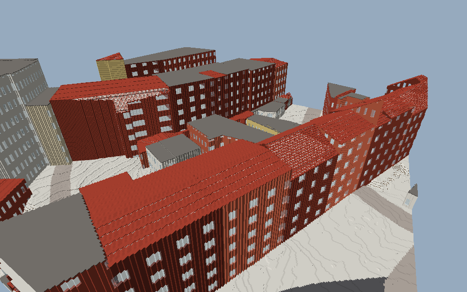
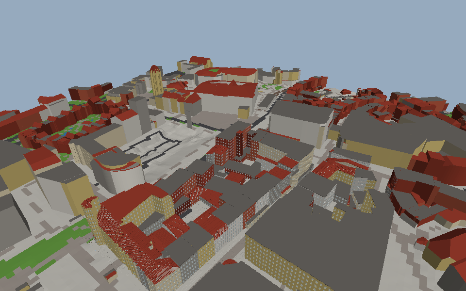

# Weltpipeline: Stand M1

Wie aus den Rohdaten Voxel-Chunks werden (Konzept, Abschnitt 2), mit den Formaten, die dabei entstehen.

```
data/raw/dgm1/*.tif  ─┐
data/raw/lod2/*.gml  ─┼─ raser import ──► world/tiles/<x>_<y>.json + .rrh ── raser voxelize ──► world/chunks/<x>_<y>/*.rrc + manifest.json
data/raw/osm/*.osm   ─┘                    (Zwischenlayer)               ▲                       (Voxel-Chunks)
                                                                    overrides/*.json
```

## Die Solution

| Projekt | Art | Inhalt |
|---|---|---|
| `src/Raser.Core` | Bibliothek (`raser.core`) | Raster und Schlüssel (`Grid`, `TileKey`, `ChunkKey`), Voxel (`Material`, `Materials`, `Palette`, `Shape`), `Chunk` mit Kodierung, globale IDs, `ByteWriter`/`ByteReader`, FNV-1a, Sortieren |
| `src/Raser.World` | Bibliothek (`raser.world`) | Zwischenlayer (`Tile`, `TileData`, `Building`, `Road`, `Area`, `Poi`, `HeightRaster`), Geometrie, Override-Layer, `Voxelizer`, `FileTileStore`, `TileGenerator` |
| `src/Raser.Import` | Bibliothek (`raser.import`) | XML-Pull-Parser, GeoTIFF (LZW, Float32), WGS84 → UTM 32, CityGML LoD2, OSM-XML, `Region` (schneidet alles in Kacheln) |
| `src/Raser.Store` | Bibliothek (`raser.store`) | der Zwischenlayer in PostGIS (`data.postgres` von fire): Merkmale global mit Geometrie (WKB, verlustfrei), eine Kachel ist eine räumliche Abfrage |
| `src/Raser.Mesh` | Bibliothek (`raser.mesh`) | Chunk-Meshing: Greedy Meshing für volle Voxel, Höhen-Schnitte als schräge Oberseiten und Trapez-Seiten, Glas und Wasser in einem eigenen Teil |
| `src/Raser.Viewer` | Programm | Betrachter mit scene3d: lädt und vernetzt die Chunk-Säulen um einen Punkt, fliegende Kamera (W/A/S/D, Q/E, Pfeile), `--shot bild.png` rendert ohne Fenster |
| `src/Raser.Tool` | Programm | `raser import`, `voxelize`, `export png`, `export obj`, `info` |

Jede Bibliothek hat ihre Tests in `testing/` (`forge test src/Raser.World/Raser.World.fireproj`, oder alle: `forge test RuhrpottRaser.firesln`).

## Ablauf

```bash
tools/fetch-bochum.sh                 # Rohdaten der Testregion (rund 230 MB)
FORGE=/pfad/zu/forge tools/build-bochum.sh
```

Das Werkzeug läuft in der VM (`forge run RuhrpottRaser.firesln -- info`), für echte Daten aber nativ: `forge build RuhrpottRaser.firesln --engine native -m RELEASE`
baut `src/Raser.Tool/bin/linux-rel/Raser.Tool`. Gemessen an der Testregion (Bochum-Innenstadt, 2 × 2 km, 49 vollständige Kacheln):

| Schritt | Dauer (nativ) |
|---|---|
| Import (4 DGM1-Kacheln, 4 LoD2-Kacheln mit rund 10.000 Gebäuden und Gebäudeteilen, 16 OSM-Ausschnitte) | rund 32 s (in PostGIS rund 80 s) |
| Voxelisierung je Kachel (rund 1.200 Chunks, 155 Mio. Voxel) | rund 47 s (49 Kacheln: 31 min, 193 MB Chunks) |
| Draufsicht je Kachel | rund 24 s |

Die Zeit der Voxelisierung geht fast ganz in die Elementzugriffe auf Byte-Puffer (docs/FIRE.md).

## PostGIS

Mit `--db postgres://host:5432/raser` (Benutzer `--db-user`, Standard `postgres`; Passwort in `RASER_DB_PASSWORD`) liest und schreibt jeder Befehl den
Zwischenlayer in PostGIS statt in `world/tiles`; die Chunks bleiben Dateien unter `--world`. Das Schema (`db/schema.sql`) legt der Store selbst an.

- Gebäude, Straßen, Flächen und POIs liegen **global** mit absoluten Koordinaten und GiST-Index; die Quelle (`lod2:...`, `osm:way/...`) ist der Schlüssel,
  dasselbe Gebäude aus zwei Kacheln ist eine Zeile. Eine Kachel ist die Abfrage über ihr Rechteck mit 1 m Rand (`&&` mit `ST_MakeEnvelope`).
- Geometrien gehen als WKB hin und zurück (`Raser.Wkb`, mit den typisierten Pufferzugriffen von fire): keine Rundung über Text.
- Testregion: 49 Kacheln, 9.165 Gebäude, 3.963 Straßen, 575 Flächen, 3.396 POIs, 30 MB; Import mit Datenbank rund 80 s (Dateien: 32 s).
- Die Voxelisierung aus PostGIS ergibt dieselben Chunks wie aus den Dateien (an der Rathaus-Kachel geprüft: 1.227 von 1.227 byte-gleich). Dafür hängt sie
  seit Generator 3 nicht mehr von der Reihenfolge der Merkmale ab: bei Gleichstand gewinnt die kleinere ID.
- Tests gegen eine Datenbank: `RASER_TEST_POSTGRES=postgres://127.0.0.1:5432/raser_test RASER_TEST_POSTGRES_PASSWORD=... forge test src/Raser.Store/Raser.Store.fireproj`
  (eine leere Datenbank mit PostGIS; ihre Tabellen werden geleert).

## Koordinaten

- Welt: ETRS89 / UTM 32N (EPSG:25832), x Ost, y Nord, z Höhe über NHN, Meter.
- Voxel: 20 cm, `floor(meter * 5)`. Chunk: 64³ Voxel = 12,8 m. Kachel: 256 × 256 m = 20 × 20 Chunk-Säulen, ohne Höhe.
- Im Zwischenlayer sind Lagen kachel-lokal (Südwest-Ecke = 0, 0), Höhen absolut.

## Zwischenlayer: `world/tiles/<x>_<y>.json` und `.rrh`

`TileData` als JSON (ohne `$type`): `quarter`, `mood`, `sources`, `buildings`, `roads`, `areas`, `pois`, `props`. Jedes Merkmal hat `id` (stabil, `Raser.Ids.Stable`) und `source`.
Merkmale, die über den Rand reichen, stehen in jeder Kachel, die ihr Rechteck berührt.

- Gebäude: aus jedem `bldg:Building`/`bldg:BuildingPart` mit eigener Geometrie, je Grundfläche eines. `footprint` (Ring), `ground` (tiefster Punkt der Grundfläche),
  `eaves`/`ridge` (tiefster/höchster Dachpunkt), `roofs` (die LoD2-Dachflächen), `roofType` (ALKIS-Dachform), `function` (`alkis=<code>`, oder ein OSM-POI im Grundriss: `amenity=fuel` ...), `name`.
- Straßen: OSM `highway=*` (ohne Tunnel, ohne `proposed`/`construction`), Bahnen (`railway=rail|light_rail|subway|tram`, ohne eingebettete Straßenbahn); Breite aus `width` oder nach Art.
- Flächen: Wasser, Parkplätze, Plätze, Sport- und Spielplätze, Wald, Grün, Felder, Bahngelände, Gewerbe/Handel - mit Priorität bei Überlappung.
- Props (Stadtmöbel und Vegetation): OSM-Knoten `natural=tree` (Höhe aus `height`, Laub/Nadel aus `leaf_type`), `highway=street_lamp`, `amenity=bench`,
  `amenity=waste_basket`, `traffic_sign=*` (das Zeichen in `detail`), `highway=traffic_signals`. Laternen, Bänke und Schilder zeigen zur nächsten Straße;
  eine Ampel auf der Fahrbahn rückt an den rechten Rand. Wälder werden alle 5 m mit einem Baum bestreut (30 % Nadelbäume), Parks alle 12 m mit jedem
  zweiten - verrückt, aus der ID der Fläche, nicht in Gebäuden und nicht auf Straßen.
- `.rrh`: das Höhenraster, 258 × 258 Höhen im Abstand von 1 m auf den Pixelmitten des DGM1 (-0,5 .. 256,5 m), in Zentimetern als Differenzen (Varints).

## Voxel-Chunks: `world/chunks/<x>_<y>/<cx>_<cy>_<cz>.rrc`

Deflate über `Chunk.Encode()`: `RRC1`, Schlüssel, Generator-Version, Hash der Overrides, Seed, dann Material + Farbe als Lauflängen (Varint-Länge, Byte, Byte),
dann die Formen (Höhen-Schnitte) und der Teilschaden als (Abstand zum vorigen Index, Byte). Leere Chunks (nur Luft) werden nicht gespeichert.

`manifest.json` hält fest, womit die Kachel erzeugt wurde: `generatorVersion`, `overridesHash`, `seed`, `dataHash` (alle Hashes als 16 Hex-Ziffern), die Chunks und die Zahl der Voxel.
`raser voxelize` überspringt Kacheln, bei denen alles passt; `--force` erzeugt neu.

## Voxelisierung

Je Chunk-Säule wird einmal ein Plan der 64 × 64 Voxel-Säulen gerechnet (gilt für alle Chunks übereinander):

- Gelände: Eckhöhen aus dem Raster an den Säulen-Ecken; die Oberfläche liegt im Voxel der höchsten Ecke, die vier Ecken auf 5 cm gerundet (Viertel). Darunter 2 Voxel
  Unterbau (Erde, unter Straßen Schotter, unter Wasser Sand), bis 2 m Erde, darunter Fels.
- Flächen und Grundrisse werden zeilenweise gerastert, Straßen segmentweise; die breiteste Straße und die Fläche mit der höchsten Priorität gewinnen.
- Gebäude: Säulen, deren Mitte im Grundriss liegt; Rand = Wand mit Fensterreihen (Glas) je Geschoss (2,8 m), innen Decken; das Dach-Voxel mit Eckhöhen aus den LoD2-Ebenen
  (sonst aus Dachform, Traufe und First). Wohnhäuser (ALKIS 31001_1xxx) in Ziegel, der Rest verputzt; Farbvarianten aus ID und Seed.
- Props: prozedurale Voxel-Modelle (`Raser.Props`: Laubbaum aus Stamm, Ästen und löchrigen Blattbüscheln, Nadelbaum als Kegel aus Ringen, Laterne,
  Bank, Papierkorb, Schild als 3 x 3-Pixelbild, Ampel), je Art, Höhe, Variante (aus der ID) und Vierteldrehung einmal gebaut; gestempelt auf das oberste
  Gelände-Voxel ihrer Säule, nur in Luft. Props der Nachbarkacheln bis 12 m an der Grenze stempelt die Kachel mit, so ragen Bäume über die Grenze.
  Die ferne Stufe zeigt Bäume als Stamm und Krone (Quader).
- Alle Lagen werden aus dem kachel-lokalen Voxel-Index gerechnet, damit Nachbar-Chunks dieselbe Säule gleich sehen. Zwei Läufe mit denselben Daten ergeben dieselben Bytes.

## Export zur Kontrolle

- `raser export png [--tile x_y] [--step n]`: Draufsicht, die Farbe des obersten Voxels je Säule mit Hangschattierung; ohne `--tile` alle Kacheln in einem Bild.
- `raser export obj --at ost,nord [--size m]`: die Chunk-Säulen um den Punkt als OBJ + MTL, vernetzt mit `Raser.Mesh` (rund 7.000 Vierecke je Chunk in der Innenstadt), für Blender oder jeden anderen Betrachter.


*Die Testregion Bochum-Innenstadt (2 × 2 km, 49 Kacheln, 0,8 m je Pixel): Flachdächer grau, Steildächer rot, Straßen, Grün, Wasser; keine Nähte an den Kachelgrenzen.*


*Ein Ausschnitt am Rathaus als Netz: Wände mit Fensterreihen je Geschoss, Decken, Flach- und Steildächer, Straße und Grünstreifen.*

## Betrachter

```bash
forge build RuhrpottRaser.firesln -p Raser.Viewer --engine native -m RELEASE
src/Raser.Viewer/bin/linux-rel/Raser.Viewer --world world --at 376130,5704900 --radius 2 --distance 110 --pitch -40 --shot rathaus.png
```

Je Chunk und Farbe wird ein scene3d-Modell aus `Model.FromArrays` gebaut (Anker auf der unteren Ecke, damit die Lage stimmt). Um das Rathaus (Radius 2, 5 × 5 Chunk-Säulen)
sind das 273 Objekte mit rund 1 Mio. Dreiecken; ein Bild von 960 × 600 braucht rund 250 ms im Software-Renderer, Laden und Vernetzen rund 10 s.

**Größe der Netze.** Geschnittene Voxel werden zusammengefasst: gleiche Oberseiten einer Schicht zu einem Viereck, solange die Fläche eben bleibt
(flach: in beide Richtungen, Rampen entlang ihrer Höhenlinie), und die Trapez-Seite zwischen zwei geschnittenen Voxeln fällt weg, wenn der Nachbar
an der gemeinsamen Kante mindestens so hoch ist. Gemessen an drei Kacheln (jede dritte Chunk-Säule, hochgerechnet):

| | vorher | jetzt |
|---|---|---|
| Vierecke je Kachel | rund 8 Mio. | 1,1 - 1,6 Mio. |
| kompakt gespeichert (12 × uint16 + Farbe + Material je Viereck, Deflate) | rund 47 MB | 10 - 14 MB |
| Rathaus, Radius 2 (Dreiecke / ein Bild 960 × 600) | 1.003.432 / 270 ms | 108.832 / 39 ms |
| Dächer östlich davon, Radius 3 | 2.208.894 / 651 ms | 588.678 / 219 ms |

Was bleibt (Innenstadt-Kachel): Gebäudeseiten rund 570.000 (Fensterreihen aus Glas-Voxeln zerschneiden die Wände, innen wie außen), Gebäude-Unterseiten
(Decken) rund 90.000, Gelände schräg oben 125.000 - 285.000 und Gelände-Seiten 120.000 - 320.000 (diagonale Formen, Stufen zwischen Schichten).
Hochgerechnet auf NRW (34.110 km²) wären das noch rund 5 - 7 TB Netze - gespeichert wird also nur um den Spieler herum. Die Chunks selbst brauchen
rund 1,3 MB je Kachel (20 MB je km², NRW grob 700 GB, eher weniger außerhalb der Städte).



**Nachladen.** Geladen wird um den Punkt, auf den die Kamera am Boden blickt (höchstens 150 m voraus), in Ringen um seine Chunk-Säule. Lesen,
Vernetzen und das Bauen der Arrays für scene3d laufen in Worker-Threads (`--workers`, Standard 3; 0: im Hauptprogramm): das Hauptprogramm schickt die
nächsten fehlenden Säulen über einen `Channel` (höchstens zwei je Worker unterwegs), übernimmt je Bild höchstens `--budget` fertige Säulen (Ergebnisse,
die zu spät kommen, fallen weg) und macht daraus nur noch `Model.FromArrays` und `Object` (rund 4 ms je Säule). Säulen weiter als Radius + 1 werden
entladen. Mit Workern kann ein Bild in einem Pixel abweichen: die Säulen kommen in anderer Reihenfolge, gleich tiefe Flächen liegen dann anders.

Ohne Fenster misst `--fly` einen Flug in Echtzeit:

```bash
Raser.Viewer --world world --at 376130,5704900 --radius 3 --distance 60 --pitch -25 --yaw 200 --size 480x300 --fly 300 --speed 15 --workers 3 --shot ende.png
```

Für die Nachbarn liest ein Worker nur deren Randschichten (`.rrb`, 6 x 64 x 64 Zellen je Chunk; für die Testregion 18 MB neben 64 MB Chunks;
`raser faces` schreibt sie zu schon voxelisierten Welten). Ein Chunk lädt in rund 1 ms (Lauflängen mit `Fill`), eine Randschicht in 0,1 ms.

Gemessen im Hauptprogramm (`--workers 0`) je Säule: Lesen rund 13 ms, Vernetzen rund 110 ms. In Workern kommt das nicht an: fire-Threads stehen, solange
das Hauptprogramm in `cam.Render()` steckt (docs/FIRE.md) - beim Flug mit 15 m/s kamen die Ergebnisse kaum an. Bis das in fire gelöst ist, ist
`--workers 0` (Laden im Hauptprogramm, `--budget` Säulen je Bild) die ehrliche Wahl; das Vernetzen ist dann der nächste Engpass.


## Detailstufen

Der Betrachter arbeitet in Blöcken von 4 x 4 Chunk-Säulen (51,2 m; fünf Blöcke sind eine Kachel), jeder Block ein scene3d-Objekt mit der Palette als
Textur (die Farbe steckt in den Texturkoordinaten):

- **Stufe 0** (`--near`, Blöcke um den Ladepunkt): die Voxel-Chunks, vernetzt mit `Raser.Mesh`, in Worker-Threads (`--workers`, Standard 3; jeder mit
  eigenem Store und eigenen Caches, bis zu den fertigen Arrays für scene3d); das Hauptprogramm macht daraus nur noch Modelle (rund 6 ms je Block). Bis ein
  Block fertig ist, bleibt seine ferne Version stehen.
  Das Gelände kommt auch hier glatt aus dem Höhenraster (Raster 0,8 m, mit Diagonalen). Die Gelände-Voxel bekommen nur dort Flächen, wo etwas in den
  Boden greift oder gegraben ist (`Raser.GroundCut`: ein Voxel, das nicht Gelände ist, bis 20 cm über der Rasterhöhe, oder eine Geländeoberkante mehr als
  45 cm neben der Rasterhöhe). Dort ist die Kante hart, und das glatte Netz spart die Zelle (80 cm) aus. Am Rathaus kostet ein naher Block damit rund 104 000
  statt 107 000 Dreiecke; die Zeit bleibt gleich, sie geht in Laden und Vernetzen der Gebäude.
- **Fern** (`--far`): `Raser.FarMesher` baut den Block direkt aus dem Zwischenlayer - Gelände als Raster (`--spacing`, Standard 3,2 m, ab dem dritten Ring
  doppelt so grob) mit den Farben der Flächen und Straßen, Gebäude als Wände bis unter die Dachfläche (in Stücken von höchstens 2 m, so folgen sie Giebeln)
  und die LoD2-Dachflächen (trianguliert). Rund 6 ms je Block.
- **Vorrat:** Was aus den Radien fällt, wird nicht verworfen. Seine Netze bleiben (ohne Objekt in der Szene - auch versteckte Objekte kosten beim
  Rendern) und sind wieder da, wenn der Block zurück in den Radius kommt. Steht der Ladepunkt (eine halbe Sekunde im selben Block) oder beim Start,
  wird über die Radien hinaus vorausgeladen: die ferne Stufe `--far-ahead` Ringe weiter (Standard: noch einmal `far`), die nahe `--near-ahead` Ringe
  (Standard 2, in den Workern). Entladen wird erst, wenn weniger als `--min-free` Prozent des Speichers frei sind (Standard 20) oder der Viewer mehr als
  `--memory-mb` belegt: dann je Sekunde ein Viertel des Vorrats, das Entfernteste zuerst, nahe Stufen vor ganzen Blöcken. Den Speicher liest der Viewer
  über `Environment.TotalMemory` / `FreeMemory` / `ProcessMemory`. Nach 1,3 km Flug mit nahen Blöcken: 709 Blöcke, 1,5 Millionen Dreiecke im
  Vorrat, 880 MB.
- Ferne Blöcke bekommen ihr Geländeraster nach dem Ring (ab dem dritten doppelt so grob); kommt ein grob gebauter Block näher, wird er fein neu gebaut.
- Je Bild wird bis `--budget-ms` gearbeitet: erst fehlende ferne Blöcke vom Ladepunkt nach außen, dann die nahen Säule für Säule. Der Ladepunkt liegt in
  Blickrichtung voraus (`--lead`, im Flug Tempo x 2,5 s): vorne wird zuerst geladen, hinten fällt zuerst weg.

Gemessen (Rathaus, 9 nahe Blöcke, 4 Kerne): ein naher Block kostet im Hauptprogramm rund 2,3 s, in einem Worker 2,9 s, mit drei Workern je 3,3 s; die
9 Blöcke sind mit drei Workern in 11,6 s statt 20,7 s da, das Bild ist dasselbe. Davon gehen 1,2 bis 2,3 s in das Vernetzen selbst, je 0,1 bis 0,2 s in
Laden, harte Säulen und Arrays. Im Flug mit 83 m/s und Rendern auf denselben Kernen braucht ein Block 4 bis 7 s - ein Block ist bei dem Tempo in 0,6 s
durchflogen. Für Tempo bleibt es bei der fernen Stufe; die nahe ist (noch) für Fuß und Stadtverkehr.

Schneller vernetzen (Profil mit callgrind, Bild jeweils gleich): ein naher Block 2,27 s -> unter 1 s. Die sichtbaren Flächen findet der Mesher über
Bit-Zeilen (je Zeile in x die 64 Voxel als Bits in Maschinenwörtern: nicht Luft, verdeckt, bringt Flächen; eine Richtung ist dann ein paar
Bit-Operationen je Zeile; breitenunabhängig, ein Test stellt 32 und 16 Bit nach); Gelände und harte Säulen sind Bits je Zeile statt eines Aufrufs je
Voxel; `GroundCut` sucht je Säule nur bis zum ersten Treffer; Formen kommen aus einer Byte-Karte statt aus dem Dictionary des Chunks; die Netze
wachsen in typisierten Arrays, die Arrays für scene3d entstehen in einem Durchgang. Was nativ teuer war, steht in docs/FIRE.md.

**Netz-Cache:** Ein gebauter naher Block wird unter `<welt>/meshes/<kachel>/<bx>_<by>.rrn` gespeichert (Deflate; Kopf `RRN1`, Version aus Cache-Format
und Generator, Geländeraster; dann je Viereck 12 float32 blocklokal und die Farbe). Gebaute und geladene Blöcke laufen durch dieselben Bytes, das Bild
ist dasselbe. Laden statt Bauen: rund 38 ms statt 1.100 ms je Block. `raser meshes [--tile x_y | --all] [--force]` baut vorab (eine Kachel rund 36 s,
8,6 MB); `voxelize` löscht den Cache der Kachel und ihrer Nachbarn. `--no-mesh-cache` im Viewer baut immer neu.

Gemessen: Flug mit 83 m/s (300 km/h) über 1,3 km quer durch die Testregion (`--near -1 --far 6`, 480 x 300): 533 ferne Blöcke, Nachladen im Mittel 3,9 ms
je Bild, Rendern rund 18 ms, rund 46 Bilder je Sekunde; nur in 51 von 718 Bildern fehlte noch ein Block.



*Nah die Voxel (mit Fenstern), weiter weg die Gebäude aus Grundriss und LoD2-Dächern (noch ohne Fassade).*

**Texturen:** Alle Blöcke teilen eine Textur von 1024 x 1024 (`Raser.Atlas`, gezeichnet mit `TextureFilter.Sharp`: scharfe Voxel, an den Kanten über
ein Pixel geglättet): je Farbe der Palette (die benannten und ihre Dreckstufen, 32 .. 127) eine Materialkachel von 64 x 64 Voxeln (ein Texel je Voxel), je Farbe eine Fassadenkachel im Fensterraster (9 x 14 Voxel) und die Palette selbst. Die
Texturkoordinaten entstehen beim Bau der Arrays aus Lage und Farbe eines Vierecks (Ebene nach der größten Richtung der Normale, an Chunk-Grenzen
ausgerichtet); Vierecke, die über einen Chunk hinausgehen (LoD2-Dächer der fernen Stufe), und freie Farben nehmen die Palette. Die ferne Stufe zeigt
die Fenster in den Ringen bis 2 als Fassade (Wände geteilt an den Grenzen des Rasters und je Geschoss), genau dort, wo die Voxel sie haben.

Offen: eine mittlere Stufe (Voxel 40/80 cm), der nahe Radius nach dem Tempo, die Fassaden-Textur mit den Fenstern ab der fernen Stufe; mit `--db`
liest der Netz-Cache die Kacheln noch aus den Dateien.

## Offen (für M1 und danach)

- Brücken und Tunnel (`layer`), Gebäudeteile über Durchfahrten, Fassaden-Grammatik (M2), Viertel-Typen aus den Daten.
- Kacheln am Rand der Region kommen erst mit den Daten der Nachbarregion.
